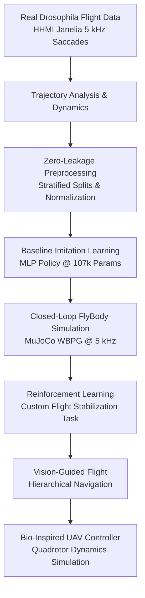

# BioFlight: Data-Driven Bio-Inspired Flight Control Using FlyBody

[](https://www.python.org/downloads/release/python-3100/)
[](https://mujoco.org/)
[](LICENSE)
[](tests/)

An open-source, scientifically rigorous AI and robotics research framework investigating whether motion and control strategies learned from real biological fruit-fly (*Drosophila melanogaster*) locomotion—via imitation learning and reinforcement learning in **FlyBody**—can provide transferable principles for autonomous unmanned aerial vehicle (UAV) navigation and stabilization.

---

## 1. Research Pipeline



---

## 2. Milestone Progress & Key Experimental Results

### Milestone 3 — Drosophila Arithmetic Selector v0.1 (COMPLETED)
Established the first complete embodied closed-loop task:

$$\text{TASK} \longrightarrow \text{DECISION} \longrightarrow \text{TARGET} \longrightarrow \text{FLIGHT} \longrightarrow \text{CONTACT} \longrightarrow \text{REWARD}$$

* **Task**: $2 + 3 = ?$ with candidate answers Left $[5]$ and Right $[7]$ inside a $12\text{ cm} \times 12\text{ cm} \times 6\text{ cm}$ 3D arena.
* **Separation of Layers**: Layer 1 (Task), Layer 2 (Decision), Layer 3 (Navigation Waypoint Adapter), Layer 4 (FlyBody MuJoCo Physics & WBPG).
* **Baselines Evaluated**:
  - **Baseline A (Oracle)**: Directly commands $[5]$. Reaches contact in $183$ steps ($36.6\text{ ms}$), min distance $0.1495\text{ cm} \le 0.150\text{ cm}$, reward $+8.18$ (`CORRECT_TARGET_CONTACT`).
  - **Baseline B (Wrong Target)**: Explicitly commands $[7]$. Contacts distractor in $182$ steps ($36.4\text{ ms}$), min distance $0.1493\text{ cm}$, reward $-11.81$ (`WRONG_TARGET_CONTACT`).
  - **Baseline C (Arithmetic Solver)**: Autonomous task solving ($2 + 3 = 5 \to \text{target\_left}$). Contacts $[5]$ in $190$ steps ($38.0\text{ ms}$), reward $+8.11$ (`CORRECT_TARGET_CONTACT`).
* **Artifacts**: Multi-view telemetry video (`videos/milestone_03_arithmetic.mp4`), structured logs (`results/milestone_03/episode_logs.json`), and documentation (`docs/milestone_03.md`).

### Closed-Loop Flight Tracking in Live MuJoCo Simulation (Phase 7)
The trained neural flight policy (`MLPPolicy`) was evaluated in closed-loop against real fruit-fly evasion saccade trajectories in `flight_imitation`:

| Metric | Result | Benchmark Description |
|---|---|---|
| **Survival / Stability** | **100%** | Zero crashes across full maneuver duration |
| **Position RMSE** | **0.35 cm (3.5 mm)** | Tracking precision over high-speed evasions |
| **Position MAE** | **0.26 cm (2.6 mm)** | Mean absolute position error |
| **Velocity RMSE** | **0.29 m/s** | Target linear velocity matching |
| **Roll (Bank) Error** | **73.6°** | Real fly executes extreme rapid rolls up to 180° |
| **Control Effort** | **4.31** | Action energy $\frac{1}{T}\sum \|a_t\|^2$ |
| **Action Smoothness** | **0.69** | Action difference variation $\frac{1}{T}\sum \|\Delta a_t\|^2$ |

---

## 3. Project Directory Structure

```text
Fruit fly/
├── configs/
│   ├── dataset.yaml            # Preprocessing, normalization & split config
│   └── imitation.yaml          # MLP architecture & training hyperparameters
├── data/
│   ├── raw/                    # Raw flight saccade HDF5 & wing pattern files
│   ├── processed/              # Normalized train/val/test splits (.npz)
│   └── README.md               # Figshare sources, metadata & dataset schemas
├── docs/
│   └── FLYBODY_ARCHITECTURE.md # MuJoCo model, WBPG, and kinematics reference
├── notebooks/
│   └── 01_dataset_exploration.ipynb # Interactive trajectory exploration
├── src/
│   ├── data/
│   │   ├── flight_dataset.py   # Trajectory loader & kinematic analyzer
│   │   ├── preprocessor.py     # Stratified zero-leakage preprocessor
│   │   └── dataset.py          # PyTorch Dataset & DataLoader constructors
│   ├── models/
│   │   └── mlp_policy.py       # Neural flight policy network
│   └── evaluation/
│       └── metrics.py          # Flight tracking, attitude & stability metrics
├── training/
│   └── train_imitation.py      # Offline imitation learning training pipeline
├── evaluation/
│   └── run_evaluation.py       # Live closed-loop MuJoCo simulation evaluation
├── tests/
│   └── test_bioflight_core.py  # Unit tests (100% passing)
├── checkpoints/
│   └── imitation/exp_001/      # Saved PyTorch model checkpoints
├── results/
│   ├── dataset_analysis/       # 3D trajectory plots, distributions & reports
│   ├── imitation/exp_001/      # Convergence curves, 3D tracking & metrics
│   └── model_inspection/       # MuJoCo hierarchy tree & JSON summaries
├── environment.yml             # Conda environment specification (Ubuntu Linux)
├── requirements.txt            # Pip / uv cross-platform requirements
└── README.md
```

---

## 4. Quickstart Guide

### Installation
```bash
# Clone and setup virtual environment with Python 3.10
uv venv .venv --python 3.10
source .venv/bin/activate  # Or .venv\Scripts\activate on Windows

# Install dependencies and local editable packages
uv pip install -r requirements.txt
uv pip install torch --index-url https://download.pytorch.org/whl/cpu
```

### Running Verification & Tests
```bash
# Real-Time Interactive Web Control Center (Live 3D Stream + Task Switcher)
python scripts/run_web_control_center.py
# Open browser at: http://localhost:8080

# Native Desktop 3D Interactive Window (GLFW Viewer)
python scripts/view_live_simulation.py --mode arithmetic
python scripts/view_live_simulation.py --mode spelling --word UDIT

# FlyDrones: 3D Connectome Drone Web Simulator (WebGL Three.js)
python scripts/run_flydrones_web.py
# Open browser at: http://localhost:8088

# FlyDrones CLI: inspect connectome circuits, demo flight, and swarm
python -m flydrones inspect
python -m flydrones demo --seconds 5
python -m flydrones swarm --seconds 10

# Milestone 1: Verify official FlyBody simulation in MuJoCo physics
python scripts/run_milestone_01.py --gui

# Milestone 2: Fully inspect observation/action interfaces & perturbation dynamics
python scripts/inspect_flybody_interface.py

# Milestone 3: Run Drosophila Arithmetic Selector v0.1 (Baselines A, B, C)
python scripts/run_milestone_03.py

# System and dependency check
python scripts/test_installation.py

# Run comprehensive test suite
pytest tests/
```

### Reproducing the Pipeline
```bash
# 1. Inspect MuJoCo model hierarchy
python scripts/inspect_model.py

# 2. Analyze biological trajectory dataset
python scripts/analyze_trajectories.py

# 3. Preprocess dataset (zero temporal leakage split)
python scripts/process_dataset.py

# 4. Train baseline imitation learning policy
python training/train_imitation.py

# 5. Run closed-loop MuJoCo flight evaluation
python evaluation/run_evaluation.py
```

---

## 5. References & Citations
- **FlyBody**: Roman Vaxenburg et al., *"Whole-body physics simulation of fruit fly locomotion"*, **Nature** 643, 1312–1320 (2025). [doi:10.1038/s41586-025-09029-4](https://doi.org/10.1038/s41586-025-09029-4).
- **Drosophila Flight Saccades**: Florian T. Muijres et al., *"Flies Evade Looming Targets by Executing Rapid Visually Directed Banked Turns"*, **Science** 344, 172-177 (2014).
- **Body Saccades Dynamics**: Florian T. Muijres et al., *"Body saccades of Drosophila consist of stereotyped banked turns"*, **J Exp Biol** 218, 864-875 (2015).
