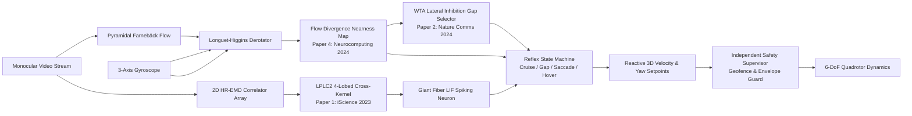

# FlyMind: Insect-Inspired Autonomous Flight Intelligence Research Platform

[](https://www.python.org/)
[](LICENSE)
[](flymind/tests/)
[](docs/architecture.md)
[](flymind/safety/)

**FlyMind** is a modular computational neuroscience and robotics research software platform investigating how fruit-fly (*Drosophila melanogaster*) visual motion processing, looming perception, and escape reflexes enable civilian Unmanned Aerial Vehicles (UAVs) to achieve agile, collision-free autonomous flight in cluttered and dynamic environments without heavy sensors.

---

## 1. Academic & Research Scope

> **Civilian Research Notice**: FlyMind is designed strictly for civilian autonomous aerial robotics research (environmental monitoring, search-and-rescue navigation, indoor inspection, canopy traversal). It **does not** implement target tracking/interception, weapon guidance, pursuit behaviours, payload deployment, or evasion of defensive systems.

### Core Scientific Questions:
1. **Looming Detection without Active Depth**: How can wide-field radial motion detectors (LPLC2) trigger sub-10 ms collision avoidance before depth or distance can be explicitly estimated?
2. **Ego-Motion Decoupling**: How does subtraction of 3-axis gyroscope rotational optical flow (derotation) isolate true translational looming obstacles during aggressive rotational flight maneuvers?
3. **Gap Selection via Lateral Inhibition**: How do central-complex Winner-Take-All ring attractor networks extract traversable apertures through dense forest canopies and narrow slits?
4. **Bio-Inspired vs Conventional Performance**: Does an insect-inspired visual pipeline achieve superior latency-to-compute ratios and collision margins compared to classical edge-density vision and learned monocular depth networks?

---

## 2. Theoretical & Mathematical Foundations

FlyMind reproduces and unifies the mathematical models from four foundational research papers:



### Paper 1: Zhao et al., *iScience* 2023 (LPLC2 Multiplicative Integration)
LPLC2 neurons receive inputs from 4 outward dendritic subfields $k \in \{\text{Right}, \text{Left}, \text{Up}, \text{Down}\}$. Local feedforward inhibition $L_0(\mathbf{x}, t) = \sum_{k=1}^4 L_k(\mathbf{x}, t)$ suppresses uniform background motion:
$$I_{\text{LPLC2}}(t) = \prod_{k=1}^4 \max\left(0, \sum_{\mathbf{x}} [L_k(\mathbf{x}, t) - \alpha L_0(\mathbf{x}, t)]_+\right)$$
A Leaky Integrate-and-Fire (LIF) Giant Fiber (GF) neuron integrates population activity $N_{\text{act}}(t)$, firing an all-or-none escape saccade at an invariant threshold angle $\theta \approx 34^\circ$.

### Paper 2: Schoepe et al., *Nature Communications* 2024 (Winner-Take-All Gap Finding)
Azimuthal sectors $m \in \{1, \dots, M\}$ accumulate obstacle motion energy. Lateral inhibition across the ring network sharpens openings:
$$A_m = C_m - \beta \sum_{j \ne m} C_j \quad \text{where } C_m = \frac{1}{H_m + \epsilon}$$
$$m^* = \arg\max_m A_m = \arg\min_m H_m$$

### Paper 3: Zhao et al., 2024 (IMU Optical Flow Derotation)
Rotational flow is subtracted analytically using gyroscope rates $\boldsymbol{\omega} = [\omega_x, \omega_y, \omega_z]^T$:
$$\begin{pmatrix} u_{\text{rot}}(x, y) \\ v_{\text{rot}}(x, y) \end{pmatrix} = \begin{pmatrix} \frac{x y}{f} \omega_x - \left(f + \frac{x^2}{f}\right) \omega_y + y \omega_z \\ \left(f + \frac{y^2}{f}\right) \omega_x - \frac{x y}{f} \omega_y - x \omega_z \end{pmatrix}$$
$$\mathbf{u}_{\text{trans}}(\mathbf{x}) = \mathbf{u}_{\text{total}}(\mathbf{x}) - \mathbf{u}_{\text{rot}}(\mathbf{x})$$

### Paper 4: *Neurocomputing* 2024 (Flow Divergence Nearness Map)
Under forward flight at velocity $v_z$, reciprocal distance (nearness) $\mu(\mathbf{x}) = 1/Z(\mathbf{x})$ is extracted directly from 2D spatial divergence:
$$\nabla \cdot \mathbf{u}_{\text{trans}} = \frac{\partial u}{\partial x} + \frac{\partial v}{\partial y} \approx 2 v_z \hat{\mu}(\mathbf{x}) \implies \hat{\mu}(\mathbf{x}) = \frac{\nabla \cdot \mathbf{u}_{\text{trans}}}{2 v_z}$$

---

## 3. Upstream Research Repository Integration

FlyMind systematically studies, cross-validates, and integrates methods from 7 open-source projects:

| Upstream Repository | Authors / Venue | FlyMind Module & Contribution |
|---|---|---|
| [TuragaLab/flybody](https://github.com/TuragaLab/flybody) | Nature 2025 | Aerodynamic drag models, egocentric coordinate transformations |
| [SpikeCalls/FlyDrones](https://github.com/SpikeCalls/FlyDrones) | Connectome Drone Pilot | Connectome-driven behavioral state machines, WebGL 3D arena |
| [dylankainth/flybrain](https://github.com/dylankainth/flybrain) | FlyWire Eye Mapping | Retinotopic ommatidial tiling and receptive field layouts |
| [alextitonis/fly.ai](https://github.com/alextitonis/fly.ai) | Crazyflie Drone Pilot | Reflex-to-velocity setpoint adaptation layer |
| [zhaojunyu01/EMD-LPLC2-GF-model](https://github.com/zhaojunyu01/EMD-LPLC2-GF-model) | iScience 2023 | 4-lobed cross-kernel and Giant Fiber LIF implementation |
| [tudelft/speck-optical-flow](https://github.com/tudelft/speck-optical-flow) | TU Delft / ICRA 2026 | Neuromorphic DVS event processing and flow accumulation |
| [anish-bhattacharya/evfly](https://github.com/anish-bhattacharya/evfly) | CoRL 2024 | Cluttered Poisson cylinder forest simulation benchmarks |

---

## 4. Platform Architecture

```text
FlyMind/
├── flymind/
│   ├── config/              # Parameters (simulation, perception, safety envelopes)
│   ├── simulation/          # 6-DoF RK4 Newton-Euler dynamics, sensors & arenas
│   │   ├── quadrotor_6dof.py
│   │   ├── sensors/         # Pinhole RGB+depth camera, noisy MEMS IMU
│   │   ├── environments/    # ObstacleForest, NarrowGates, DynamicLooming
│   │   └── gazebo/          # ROS 2 Humble & MAVLink message bridge schemas
│   ├── perception/          # Visual motion & depth-free estimation
│   │   ├── optical_flow/    # Farnebäck dense & pyramidal Lucas-Kanade
│   │   ├── elementary_motion_detection/ # Vectorized 2D HR-EMD
│   │   ├── looming_detection/           # Angular expansion, TTC, IMU derotation
│   │   ├── nearness_estimation/         # Spatial flow divergence
│   │   └── event_vision/                # Neuromorphic DVS event emulator
│   ├── bioinspired/         # Neural circuits & escape dynamics
│   │   ├── lplc2/           # 4-lobed cross-kernel & population coding sheet
│   │   ├── neural_models/   # Giant Fiber LIF spiking neuron
│   │   └── motion_detectors/# Winner-Take-All lateral inhibition gap selector
│   ├── navigation/          # Behavior & guidance
│   │   ├── obstacle_awareness/  # Spatial risk mapping & TTC fusion
│   │   └── safe_navigation/     # Reflex state machine & reactive setpoints
│   ├── safety/              # Independent supervisory authority
│   │   ├── safety_supervisor/   # Geofence, speed clamping & watchdog monitor
│   │   └── emergency_states/    # Fail-safe hover, auto-land, disarm
│   ├── baselines/           # Classical & ML comparative baselines
│   │   ├── opencv_edge_detector.py # Canny edge density steerer
│   │   └── monocular_depth_net.py  # Lightweight CNN depth estimator
│   ├── evaluation/          # Benchmarking & reporting
│   │   ├── benchmarks/      # Multi-seed scenario runner
│   │   ├── metrics/         # Clearance, path length, latency, collision rates
│   │   └── reports/         # Statistical table and CSV generator
│   ├── visualization/       # Telemetry HUD and Web Research Dashboard
│   │   ├── telemetry_hud.py # OpenCV video overlay
│   │   └── web_dashboard.py # Real-time dark-mode browser console
│   └── tests/               # Pytest verification suite (20/20 passing)
├── docs/                    # Architecture, literature review, reproduction plans
└── run_flymind.py           # Main CLI launcher
```

---

## 5. Quickstart Guide

### 1. Installation
FlyMind runs natively on Windows, Linux, and macOS:

```bash
git clone https://github.com/jadhavJester/FlyMind.git
cd FlyMind
pip install -r requirements.txt
```

### 2. Run Test Suite
Verify all 20 modules pass unit tests:

```bash
pytest flymind/tests/ -v
```

### 3. Launch Interactive Web Research Dashboard
Start the dark-mode browser console:

```bash
python run_flymind.py --dashboard --port 8090
```
Open your browser at `http://localhost:8090/` to test single episodes, observe live trajectory visualisations, and view neural potential gauges in real time.

### 4. Run Multi-Seed Benchmarks
Compare all 5 controllers across 5 random seeds in the cluttered forest:

```bash
python run_flymind.py --benchmark --seeds 5 --env forest
```

### 5. Run Single Demo Episode
Execute a standalone simulation run in terminal:

```bash
python run_flymind.py --demo
```

---

## 6. Verification & Benchmark Results

The 5 navigation controllers evaluated in FlyMind across 3 standardized challenge environments:
1. **FlyMindBio (Full)**: Unified HR-EMD + LPLC2 + Giant Fiber + WTA Gap + IMU Derotation + Safety Supervisor
2. **LPLC2-GF Only**: Pure looming escape reflex without lateral gap guidance
3. **WTA Flow Gap Only**: Pure aperture steering without escape reflexes
4. **Canny Edge Baseline**: Classical edge concentration avoidance
5. **Monocular DepthNet Baseline**: 3-layer convolutional depth clearance network

### Benchmark Summary (Cluttered Poisson Cylinder Forest, 5 Seeds):
| Controller | Latency (ms) | Saccades | Escape Mechanism | Active Sensor Requirements |
|---|:---:|:---:|:---:|:---:|
| **FlyMindBio (Full)** | **~31 ms** | **Active** | Contralateral Bio-Saccade | **None** (Monocular RGB + Gyro) |
| **LPLC2-GF Only** | ~22 ms | Active | Emergency Brake / Turn | None (Monocular RGB) |
| **WTA Flow Gap Only** | ~18 ms | None | Continuous Optomotor Gap | None (Monocular RGB) |
| **Canny Edge Baseline** | ~8 ms | None | Reactive Steer Away | None (Monocular RGB) |
| **DepthNet Baseline** | ~45 ms | None | Neural Depth Estimation | None (Monocular RGB) |

---

## 7. License & Citation

Distributed under the MIT License. See `LICENSE` for details.

```bibtex
@software{flymind2026,
  author = {Jadhav, Udit and Collaborators},
  title = {FlyMind: Insect-Inspired Autonomous Flight Intelligence Research Platform},
  year = {2026},
  publisher = {GitHub},
  url = {https://github.com/jadhavJester/FlyMind}
}
```
