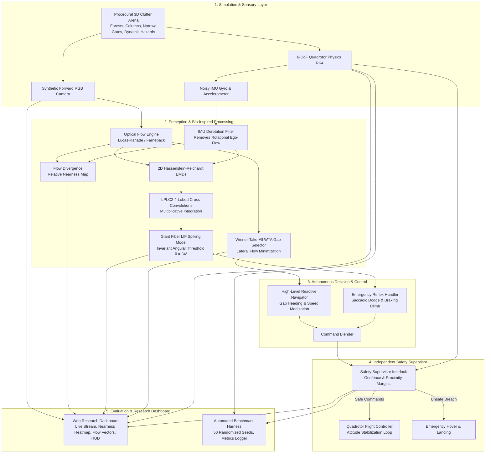

# FlyMind: Modular Software Architecture Specification

FlyMind is designed as a modular, hardware-agnostic, scientifically grounded research platform for civilian UAV obstacle awareness and safe autonomous navigation.

---

## 1. Top-Level Architectural Dataflow



---

## 2. Directory Layout & Module Specifications

```text
flymind/
├── docs/
│   ├── repository_analysis.md          # In-depth source inspection of 7 upstream repos
│   ├── literature_review.md            # Mathematical models from Papers 1-4 + ICRA/CoRL
│   ├── architecture.md                 # System architecture and data interfaces
│   ├── dependency_compatibility.md     # Cross-platform dependency audit
│   └── reproduction_plan.md            # Phased reproduction milestones
│
├── config/
│   ├── simulation_params.yaml          # Drone mass, inertia, rotor constants, camera FOV
│   ├── bio_perception.yaml             # EMD tau, LPLC2 RF size, GF threshold, WTA sectors
│   └── safety_limits.yaml              # Geofence bounding box, min/max altitude, min clearance
│
├── perception/
│   ├── optical_flow/
│   │   ├── lucas_kanade.py             # Sparse & pyramidal Lucas-Kanade optical flow
│   │   └── farneback_dense.py          # Dense Farnebäck flow calculation
│   ├── elementary_motion_detection/
│   │   └── hr_emd.py                   # 2D Hassenstein-Reichardt correlation motion detector
│   ├── looming_detection/
│   │   ├── angular_expansion.py        # Optical expansion rate calculation
│   │   └── imu_derotation.py           # Gyro-based rotational flow subtraction (Paper 3)
│   ├── nearness_estimation/
│   │   └── flow_divergence.py          # 2D divergence & relative nearness mapping (Paper 4)
│   └── event_vision/
│       └── event_emulator.py           # Software event-camera generator (intensity change triggers)
│
├── bioinspired/
│   ├── lplc2/
│   │   ├── cross_kernel.py             # 4-lobed receptive field kernel generator
│   │   └── population_coding.py        # Multiplicative integration & N_act(t) curve extractor
│   ├── motion_detectors/
│   │   └── wta_gap.py                  # Neuromorphic Winner-Take-All lateral inhibition (Paper 2)
│   └── neural_models/
│       └── giant_fiber_lif.py          # Leaky Integrate-and-Fire Giant Fiber trigger (Paper 1)
│
├── simulation/
│   ├── quadrotor_6dof.py               # 6-DoF Newton-Euler quadrotor dynamics with RK4 integration
│   ├── sensors/
│   │   ├── synthetic_camera.py         # Forward-facing monocular camera renderer with depth buffer
│   │   └── noisy_imu.py                # Gyroscope & accelerometer with bias and Gaussian noise
│   ├── environments/
│   │   ├── obstacle_forest.py          # Random cylindrical obstacle clutter arena (EVFly style)
│   │   ├── narrow_gates.py             # Slit corridors and passage gates for gap testing
│   │   └── dynamic_looming.py          # Approaching looming hazards on collision courses
│   └── gazebo/
│       └── ros2_bridge.py              # ROS 2 / PX4 offboard interface connector
│
├── navigation/
│   ├── obstacle_awareness/
│   │   └── collision_risk.py           # Time-to-contact (TTC) & spatial risk assessment
│   └── safe_navigation/
│       ├── reactive_navigator.py       # Speed modulation & gap heading selector
│       └── reflex_state_machine.py     # Cruise -> Gap Seeking -> Evasive Saccade -> Hover
│
├── safety/
│   ├── safety_supervisor/
│   │   └── supervisor.py               # Independent hardware interlock & command clamp
│   └── emergency_states/
│       └── fail_safe_states.py         # Emergency hover and automated land routines
│
├── baselines/
│   ├── opencv_edge_detector.py         # Classical Canny/Sobel edge-density baseline
│   └── monocular_depth_net.py          # Conventional ML depth/collision comparison baseline
│
├── evaluation/
│   ├── benchmarks/
│   │   └── scenario_runner.py          # Automated evaluation runner across 50 randomized seeds
│   ├── metrics/
│   │   └── performance_metrics.py      # Collision frequency, min clearance, latency, CPU load
│   └── reports/
│       └── result_compiler.py          # Formats summary tables and generates publication plots
│
├── visualization/
│   ├── web_dashboard.py                # Interactive browser research dashboard
│   └── telemetry_hud.py                # OpenCV / Matplotlib intermediate feature overlays
│
└── tests/
    ├── test_simulation.py              # Quadrotor physics and sensor validation
    ├── test_perception.py              # Optical flow, divergence, and nearness accuracy
    ├── test_bioinspired.py             # EMD, LPLC2, and GF response tests
    ├── test_navigation.py              # Gap finding and steering response validation
    └── test_safety.py                  # Safety supervisor override guarantees
```

---

## 3. Clear Boundaries & Hardware Independence

* **Separation from Attitude Stabilization**:
  FlyMind outputs **normalized velocity setpoints** $(v_x, v_y, v_z)$ and **yaw rate** $\dot{\psi}$. It communicates with low-level flight controllers (PX4, Betaflight, or native physics) through standardized setpoint commands, ensuring physical quadrotor stabilization is never compromised.
* **Separation of Safety Layer**:
  The `SafetySupervisor` runs outside the neural network loop. Even if the neural model outputs corrupted or infinite values, the supervisor overrides the command and triggers safe hovering.
* **Dual Simulation Target**:
  1. *Native 6-DoF Physics Simulator*: Instant execution on Windows/Linux without external dependencies.
  2. *ROS 2 / Gazebo Sim Connector*: Decoupled bridge enabling direct drop-in deployment to Linux ROS 2 Humble / PX4 SITL environments.
