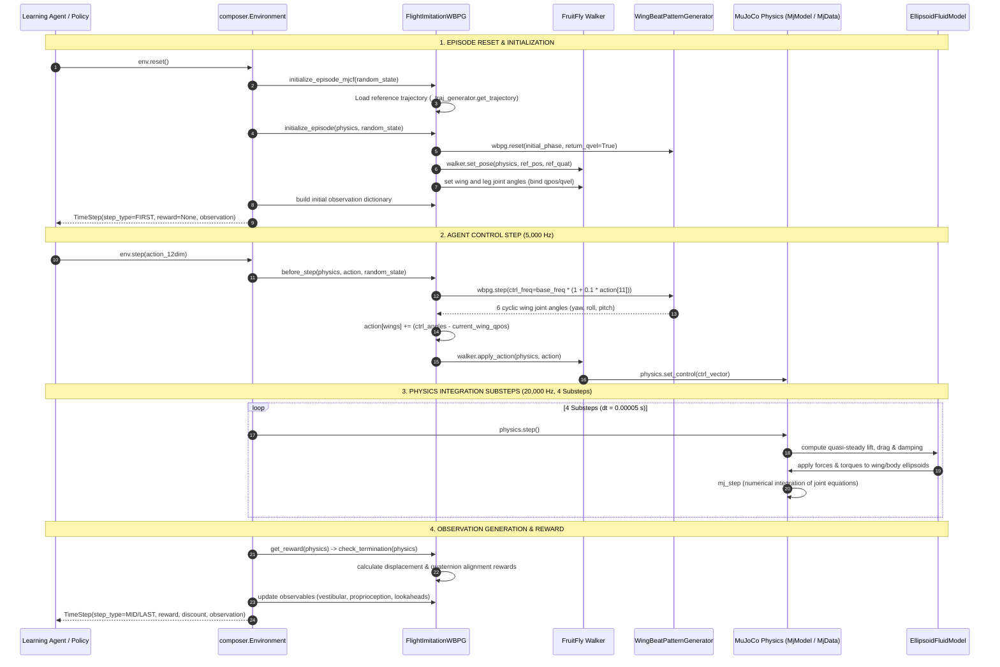

# Milestone 2: Source Code Execution Trace

This document details the exact execution path across the official FlyBody source code (`upstream/flybody`), tracing each phase of the agent-environment control loop from initialization and reset, through observation generation, policy decision, action mapping, physics substep integration, and loop closure.

---

## 1. High-Level Architectural Flowchart

---

## 2. Stage-by-Stage Source Code Trace

### Stage 1: Environment Initialization & Reset
* **Trigger**: `env = flybody.fly_envs.flight_imitation(...)`, followed by `timestep = env.reset()`.
* **Classes & Files**:
  * `flybody/fly_envs.py:flight_imitation()`: Configures walker constructor (`fruitfly.FruitFly`), arena (`floors.Floor`), wing beat generator (`WingBeatPatternGenerator`), and trajectory loader (`HDF5FlightTrajectoryLoader` or `InferenceFlightTrajectoryLoader`). Instantiates `FlightImitationWBPG` inside `dm_control.composer.Environment`.
  * `flybody/tasks/flight_imitation.py:FlightImitationWBPG.__init__()`:
    * Registers ghost walker reference: `self._ghost = walker(name='ghost', use_wings=False, use_legs=False)`.
    * Attaches task-specific observables: `walker/ref_displacement` and `walker/ref_root_quat`.
    * Indexes action classes: `_wing_inds_action` (indices 3..8), `_user_idx_action` (index 11).
  * `flybody/fruitfly/fruitfly.py:FruitFly.__init__()`:
    * Loads XML model: `assets/fruitfly.xml`.
    * Disables legs (when `disable_legs=True`): removes 66 leg joints, 66 actuators, tendons, and adhesion geoms.
    * Sets up wing actuators and default pitch angle ($47.5^\circ$).
    * Builds `_ACTION_CLASSES`: `head` (3), `wings` (6), `abdomen` (2), `user` (1) = 12 total.
  * `flybody/tasks/flight_imitation.py:initialize_episode_mjcf()`:
    * Loads trajectory from HDF5: `self._traj_generator.get_trajectory()`.
    * Computes root joint position from CoM via `com2root()`.
  * `flybody/tasks/flight_imitation.py:initialize_episode()`:
    * Resets WBPG phase: `init_wing_qpos, init_wing_qvel = self._wbpg.reset()`.
    * Positions fly root: `self._walker.set_pose(physics, ref_pos, ref_quat)`.
    * Initializes wing joint angles: `physics.bind(self._wing_joints).qpos = init_wing_qpos`.
    * Initializes linear velocity: `self._walker.set_velocity(physics, ref_qvel[:3])`.

---

### Stage 2: Observation Generation
* **Trigger**: Invoked at reset and after physics stepping in `composer.Environment`.
* **Classes & Files**:
  * `dm_control/composer/observation/observable.py`: Manages evaluation, caching, and buffering of observables.
  * `flybody/fruitfly/fruitfly.py:FruitFlyObservables`:
    * `walker/accelerometer`: Line 642, reads specific force from MuJoCo sensor (`(3,)`, thorax frame).
    * `walker/gyro`: Line 651, reads angular velocity vector from sensor (`(3,)`, thorax frame).
    * `walker/velocimeter`: Line 659, reads linear velocity vector from sensor (`(3,)`, thorax frame).
    * `walker/world_zaxis`: Line 611, calculates world z-vector $[0, 0, 1]^T$ expressed in local thorax frame (`(3,)`).
    * `walker/joints_pos` & `joints_vel`: Lines 719, reads positions and velocities across 25 active joints (`(25,)` and `(25,)`).
    * `walker/actuator_activation`: Line 668, reads actuator dynamic filter states (`(0,)` when filter disabled).
  * `flybody/tasks/base.py:FruitFlyTask`:
    * `walker/ref_displacement`: Lines 246–256. Extracts current and 5 future reference positions ($k = 0 \dots 5$), computes displacement vectors $\mathbf{p}_{ref, k} - \mathbf{p}_{fly}$, and projects them into the fly's egocentric frame (`(6, 3)` = 18 dims).
    * `walker/ref_root_quat`: Lines 259–268. Computes relative local orientation quaternions between fly attitude and reference attitude using `flybody.quaternions.get_dquat_local` (`(6, 4)` = 24 dims).
* **Output**: Flattened array or dictionary aggregating exactly 104 continuous numerical observables.

---

### Stage 3: Policy / Controller Evaluation
* **Trigger**: `action = policy(observation)` or manual modulation array.
* **Format**: Continuous 12-dimensional vector $\mathbf{a} \in \mathbb{R}^{12}$, where channels $0 \dots 10$ modulate joint/wing biases and channel 11 modulates wingbeat frequency bias.

---

### Stage 4: Action Mapping & Wing Beat Pattern Generator Integration
* **Trigger**: `env.step(action)`.
* **Classes & Files**:
  * `flybody/tasks/flight_imitation.py:before_step()`:
    1. Extracts frequency bias action: `act = action[self._user_idx_action]` (channel 11, range $[-1, 1]$).
    2. Calculates target flapping frequency:
       $$\text{ctrl\_freq} = \text{base\_freq} \times (1 + \text{rel\_freq\_range} \times \text{act}) = 218\text{ Hz} \times (1 + 0.1 \times a_{11})$$
    3. Evaluates WBPG: `ctrl = self._wbpg.step(ctrl_freq=ctrl_freq)`. Returns 6 kinematic wing angles $(\psi_L, \phi_L, \theta_L, \psi_R, \phi_R, \theta_R)$.
    4. Computes wing position error and converts to force control:
       $$\mathbf{a}_{wings} \leftarrow \mathbf{a}_{wings} + (\mathbf{ctrl}_{wbpg} - \mathbf{q}_{pos, wings})$$
    5. Advances ghost walker along reference trajectory: `self._ghost.set_pose(...)`.
  * `flybody/fruitfly/fruitfly.py:FruitFly.apply_action()`:
    1. Stores `_prev_action[:] = action`.
    2. Maps action channels into MuJoCo actuator control vector:
       * `ctrl[0..2] = action[0..2]` $\to$ `head_abduct`, `head_twist`, `head`
       * `ctrl[3..8] = action[3..8]` $\to$ `wing_yaw_left..wing_pitch_right`
       * `ctrl[9..10] = action[9..10]` $\to$ `abdomen_abduct`, `abdomen`
    3. Sends vector to MuJoCo: `physics.set_control(ctrl)`.

---

### Stage 5: Physics Substep Integration & Aerodynamics
* **Trigger**: `composer.Environment` executes 4 physics steps per control update.
* **Classes & Files**:
  * `flybody/tasks/base.py`:
    * Physics timestep: $dt = 5 \times 10^{-5}\text{ s}$ ($20,000\text{ Hz}$).
    * Control timestep: $\Delta t = 2 \times 10^{-4}\text{ s}$ ($5,000\text{ Hz}$).
    * Substeps per control update: $\Delta t / dt = 4$.
  * `flybody/ellipsoid_fluid_model.py:EllipsoidFluidModel`:
    * MuJoCo fluid callback calculates quasi-steady aerodynamics on wing and body ellipsoids.
    * Evaluates instantaneous angle-of-attack $\alpha$, relative fluid velocity $\mathbf{v}_{rel}$, and angular velocity $\boldsymbol{\omega}$.
    * Generates lift force $\mathbf{L} \propto C_L(\alpha) v^2$, drag force $\mathbf{D} \propto C_D(\alpha) v^2$, and rotational damping torques $\boldsymbol{\tau}_{damp}$.
  * `mujoco.mj_step()`: Integrates equations of motion forward by $dt$.

---

### Stage 6: Termination Check, Reward & Loop Closure
* **Classes & Files**:
  * `flybody/tasks/flight_imitation.py:check_termination()`:
    * Verifies height: $\text{thorax\_height} \ge \text{terminal\_height}$ ($0.05\text{ cm}$).
    * Verifies CoM error: $\|\mathbf{p}_{com} - \mathbf{p}_{ghost}\| \le \text{terminal\_com\_dist}$ ($2.0\text{ cm}$).
    * Verifies trajectory limit: checks if current step reaches end of reference trajectory.
    * Verifies numerical stability: acceleration norm $\|\ddot{\mathbf{q}}\| \le 10^7\text{ rad/s}^2$.
  * `flybody/tasks/flight_imitation.py:get_reward_factors()`:
    * Computes spatial displacement tolerance reward: $\text{rewards.tolerance}(\|\mathbf{p}_{com} - \mathbf{p}_{ghost}\|)$.
    * Computes quaternion attitude alignment reward: $\text{rewards.tolerance}(\text{quat\_dist})$.
    * Product of terms yields scalar step reward $r_t$.
  * `composer.Environment`: Packs `TimeStep(step_type, reward, discount, observation)` and returns to caller.
