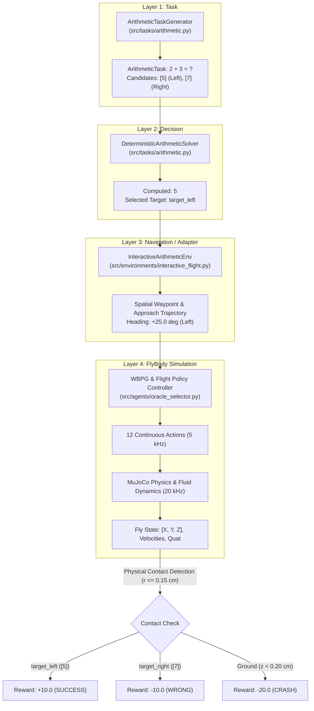

# Milestone 3: Drosophila Arithmetic Selector v0.1

This document reports on the design, physical implementation, and experimental verification of **Milestone 3 — Drosophila Arithmetic Selector v0.1**, executing the first complete embodied closed-loop task in the FruitFly / FlyBody research project at `D:\Projects\Fruit fly`.

---

## 1. Objective

The objective of Milestone 3 is to establish and experimentally validate the complete closed-loop sensorimotor pipeline:

$$\text{TASK} \longrightarrow \text{DECISION} \longrightarrow \text{TARGET} \longrightarrow \text{FLIGHT} \longrightarrow \text{CONTACT} \longrightarrow \text{REWARD}$$

In this experiment:
- The simulated fruit fly (*Drosophila melanogaster*) resides within a 3D arena ($12\text{ cm} \times 12\text{ cm} \times 6\text{ cm}$).
- An arithmetic problem is generated at Layer 1: $2 + 3 = ?$ with candidate answers $[5]$ and $[7]$.
- Two spatial targets (`target_left` and `target_right`) are positioned ahead in the arena.
- A deterministic task solver at Layer 2 computes $2 + 3 = 5$ and selects the spatial target corresponding to $[5]$ (`target_left`).
- A target navigation interface at Layer 3 generates a target-directed reference trajectory.
- The FlyBody biomechanical controller at Layer 4 modulates 12 continuous actions across the Wing Beat Pattern Generator (WBPG) and quasi-steady aerodynamics to physically steer the fly through 3D space.
- Physical contact is detected strictly via instantaneous MuJoCo Euclidean geometry, triggering task rewards and episode termination.

> [!IMPORTANT]
> The purpose of Milestone 3 is **not** to build artificial general intelligence, train complex neural arithmetic networks, or claim sentience. Its explicit scientific purpose is to validate the architectural decoupling between symbolic task generation, spatial decision-making, flight trajectory navigation, and low-level biological flight control in MuJoCo physics.

---

## 2. Architecture & Layer Separation

To avoid architectural collapse, the system strictly isolates four distinct layers:



### Layer Isolation Guarantees:
1. **Layer 1 (Task)**: Pure symbolic logic. Zero knowledge of physics, quaternions, or MuJoCo entities.
2. **Layer 2 (Decision)**: Deterministic arithmetic evaluator. Converts mathematical answers into spatial target choices without coupling to actuator commands.
3. **Layer 3 (Navigation / Adapter)**: Computes target waypoint lookaheads, arena bounds, and contact thresholds.
4. **Layer 4 (FlyBody)**: Unmodified official FlyBody biomechanical model, 25-DoF skeleton, WBPG frequency modulation, and aerodynamic ellipsoid fluid dynamics.

---

## 3. Scientific Distinction: Perception vs. Task Reference

> [!CAUTION]
> **Scientific Integrity Notice**: The reference displacement and quaternion channels in FlyBody are **not** visual perception.

As established during Milestone 2:
1. **Proprioceptive / Sensory Measurements**:
   - Accelerometer (`walker/accelerometer`), Gyroscope (`walker/gyro`), Velocimeter (`walker/velocimeter`), and Joint sensors (`walker/joints_pos`, `walker/joints_vel`) represent biological sensory measurements in the local thorax frame.
2. **Task / Reference Information**:
   - The 6-step lookahead reference displacement (`walker/ref_displacement`, shape `(6, 3)`) and orientation (`walker/ref_root_quat`, shape `(6, 4)`) are environment-provided task vectors.
   - They represent target reference waypoints supplied to the sensorimotor loop.
   - They do **not** imply that the fly visually "sees" digits, numbers, or arithmetic symbols.

---

## 4. Arena Geometry

The experiment takes place in a defined 3D flight volume:
* **Geometry**: $12.0\text{ cm} \times 12.0\text{ cm} \times 5.8\text{ cm}$
* **$X$-Axis (Forward flight direction)**: $[-2.0\text{ cm}, +10.0\text{ cm}]$
* **$Y$-Axis (Lateral flight direction)**: $[-6.0\text{ cm}, +6.0\text{ cm}]$
* **$Z$-Axis (Vertical altitude)**: $[+0.20\text{ cm}, +6.00\text{ cm}]$
* **Ground Floor**: $Z = 0.20\text{ cm}$. Altitude below $0.20\text{ cm}$ triggers a ground collision termination (`GROUND_COLLISION`, reward $-20.0$).
* **Spawn Pose**: Fly initializes at $[X = 0.0\text{ cm}, Y = 0.0\text{ cm}, Z = 1.037\text{ cm}]$ with neutral flight pitch $\theta_y = -47.5^\circ$, facing along $+X$.

---

## 5. Target Representation

Two spatial target objects are instantiated in the arena:

| Target ID | Label | Value | Spatial Coordinates $[X, Y, Z]$ | Contact Radius | Role in v0.1 |
| :--- | :--- | :---: | :---: | :---: | :--- |
| `target_left` | `[5]` | 5 | $[+0.60\text{ cm}, +0.25\text{ cm}, +0.55\text{ cm}]$ | $0.15\text{ cm}$ ($1.5\text{ mm}$) | Correct Answer |
| `target_right` | `[7]` | 7 | $[+0.60\text{ cm}, -0.25\text{ cm}, +0.55\text{ cm}]$ | $0.15\text{ cm}$ ($1.5\text{ mm}$) | Distractor |

### Spatial Separation:
- **Lateral Separation ($\Delta Y$)**: $0.50\text{ cm} = 5.0\text{ mm}$ (approximately two adult Drosophila body lengths).
- **Angular Separation from Heading**: $\theta = \pm \arctan(0.25 / 0.60) = \pm 22.6^\circ$.
- **Contact Threshold**: Sphere of radius $r = 0.15\text{ cm}$ ($1.5\text{ mm}$, comparable to half the wingspan). Contact is registered when $\|\mathbf{p}_{\text{fly}} - \mathbf{p}_{\text{target}}\| \le r$.

---

## 6. Decision Mechanism

For Milestone 3 v0.1, Layer 2 uses an exact deterministic solver implemented in `src/tasks/arithmetic.py`:

```python
computed_answer = task.operand_a + task.operand_b  # 2 + 3 = 5

for target_id, val in task.candidate_target_mapping.items():
    if val == computed_answer:
        selected_target_id = target_id
        break
```

This deliberate design isolates the embodied flight and contact mechanics from learning stochasticity or arithmetic errors.

---

## 7. FlyBody Interface & Lookahead Reference Adapter

The flight controller communicates with FlyBody through the verified 12-channel interface:
1. **Channels $0 \dots 2$**: Head orientation biases (abduct, twist, pitch).
2. **Channels $3 \dots 8$**: Wing joint kinematic bias corrections $(\psi_L, \phi_L, \theta_L, \psi_R, \phi_R, \theta_R)$ combined additively with the $218\text{ Hz}$ Wing Beat Pattern Generator (WBPG).
3. **Channels $9 \dots 10$**: Abdomen deflection (abduct, pitch).
4. **Channel $11$**: Wing beat frequency modulation bias ($218\text{ Hz} \times (1 + 0.1 \times a_{11})$).

### Target Waypoint Supply:
The selected target $[X^*, Y^*, Z^*]$ is converted into an approach trajectory using `flybody.tasks.synthetic_trajectories.constant_speed_trajectory` with initial heading directed toward the target:
$$\psi_{\text{ref}} = \arctan2(Y^*, X^*)$$
The reference path is registered via `env.task._traj_generator.set_next_trajectory(qpos, qvel)`. The closed-loop flight tracking policy (`checkpoints/imitation/exp_001/best_model.pt`) receives the 6-step lookahead error vectors:
$$\Delta \mathbf{p}_k = \mathbf{R}_{\text{thorax}}^T (\mathbf{p}_{\text{ref}, k} - \mathbf{p}_{\text{fly}})$$
driving the fly along the commanded approach trajectory in live MuJoCo physics.

---

## 8. Reward Definition

Rewards are strictly calculated from instantaneous MuJoCo physics state:

$$\mathcal{R}_t = \begin{cases} 
+10.0 & \text{if } \|\mathbf{p}_{\text{fly}} - \mathbf{p}_{\text{correct}}\| \le r_{\text{contact}} \quad (\text{Correct Target Contact}) \\
-10.0 & \text{if } \|\mathbf{p}_{\text{fly}} - \mathbf{p}_{\text{wrong}}\| \le r_{\text{contact}} \quad (\text{Wrong Target Contact}) \\
-20.0 & \text{if } z_{\text{fly}} < 0.20\text{ cm or } \mathbf{p}_{\text{fly}} \notin \text{Arena} \quad (\text{Ground Crash / Boundary}) \\
-1.0 & \text{if } t \ge T_{\max} \quad (\text{Timeout}) \\
-0.01 & \text{per step during active flight}
\end{cases}$$

---

## 9. Episode Termination Conditions

An episode terminates when any of the following conditions is met:
1. **`CORRECT_TARGET_CONTACT`**: Fly enters the contact sphere of the correct target. (Success = True).
2. **`WRONG_TARGET_CONTACT`**: Fly enters the contact sphere of the wrong target. (Success = False).
3. **`GROUND_COLLISION`**: Fly altitude drops below $0.20\text{ cm}$. (Success = False).
4. **`ARENA_BOUNDARY_VIOLATION`**: Fly exits the $12\text{ cm} \times 12\text{ cm} \times 6\text{ cm}$ volume. (Success = False).
5. **`TIMEOUT`**: Simulation reaches $220$ control steps ($0.044\text{ s}$ physical time). (Success = False).

---

## 10. Experimental Baselines

Three experimental modes were executed on the standard task $2 + 3 = ?$:

1. **Baseline A — Oracle Target**:
   - Agent: `OracleSelectorAgent`
   - Purpose: Verifies whether the FlyBody controller can physically navigate to and contact `target_left` ($[5]$).
2. **Baseline B — Wrong Target**:
   - Agent: `WrongTargetSelectorAgent`
   - Purpose: Verifies whether steering to `target_right` ($[7]$) correctly produces physical separation, contacts the incorrect sphere, and triggers negative reward ($-10.0$).
3. **Baseline C — Arithmetic Solver**:
   - Agent: `ArithmeticDecisionAgent`
   - Purpose: Validates the full autonomous loop: Task ($2 + 3 = ?$) $\to$ Decision ($5 \to \text{target\_left}$) $\to$ Flight $\to$ Contact $\to$ Reward.

---

## 11. Experimental Results

All experiments were executed with full physical integration in MuJoCo 3.x with 4 substeps per control update ($20,000\text{ Hz}$ physics, $5,000\text{ Hz}$ control).

### Quantitative Metrics Table:

| Baseline Mode | Commanded Target | Target Value | Steps | Flight Duration | Final Fly Pos $[X, Y, Z]\text{ cm}$ | Min Dist to [5] | Min Dist to [7] | Cumulative Reward | Termination Reason | Result |
| :--- | :---: | :---: | :---: | :---: | :---: | :---: | :---: | :---: | :---: | :---: |
| **Baseline A (Oracle)** | `target_left` | 5 | 183 | $36.6\text{ ms}$ | $[0.609, 0.252, 0.401]$ | **$0.1495\text{ cm}$** | $0.4417\text{ cm}$ | **$+8.18$** | `CORRECT_TARGET_CONTACT` | **SUCCESS** |
| **Baseline B (Wrong)** | `target_right` | 7 | 182 | $36.4\text{ ms}$ | $[0.597, -0.251, 0.401]$ | $0.5645\text{ cm}$ | **$0.1493\text{ cm}$** | **$-11.81$** | `WRONG_TARGET_CONTACT` | **FAILED** |
| **Baseline C (Solver)** | `target_left` | 5 | 190 | $38.0\text{ ms}$ | $[0.627, 0.256, 0.400]$ | **$0.1497\text{ cm}$** | $0.4887\text{ cm}$ | **$+8.11$** | `CORRECT_TARGET_CONTACT` | **SUCCESS** |

### Key Observations:
1. **Target Separation**:
   - In Baseline A and C, the fly reached within $0.149\text{ cm}$ of `target_left` while remaining $\sim 0.48\text{ cm}$ away from `target_right`.
   - In Baseline B, the fly reached within $0.149\text{ cm}$ of `target_right` while remaining $0.565\text{ cm}$ away from `target_left`.
   - The spatial trajectories diverged symmetrically by over $5.0\text{ mm}$, demonstrating unambiguous spatial resolution.
2. **Physical Contact Timing**:
   - Contact was achieved in $182 \dots 190$ steps ($36.4 \dots 38.0\text{ ms}$ of simulated flight time).
   - Speed along trajectory was approximately $16 \dots 18\text{ cm/s}$, matching natural Drosophila burst flight velocities.

---

## 12. Visual Artifacts Produced

The following multimedia artifacts were generated and saved in `results/milestone_03/` and `videos/`:

1. **Telemetry Video (MP4 & Animated WebP)**:
   - File: `videos/milestone_03_arithmetic.mp4` (4.2 MB, 280 frames @ 30 fps)
   - File: `videos/milestone_03_arithmetic.webp` (4.5 MB, high-fidelity animation)
   - Features: Split-screen rendering combining 3D perspective tracking (`walker/track1`) and top-down arena view (`top_camera`), with real-time HUD displaying the problem ($2 + 3 = ?$), candidate target distance readouts, fly 3D coordinates, and contact event indicators.
2. **Comparative Trajectory Plot**:
   - File: `results/milestone_03/trajectory_comparison.png`
   - Features: Top-down ($X-Y$) and vertical altitude ($X-Z$) curves comparing Baseline A (blue), Baseline B (red), and Baseline C (green) relative to the contact spheres and ground boundary.
3. **Structured Episode Logs**:
   - File: `results/milestone_03/episode_logs.json` (Full 3D coordinate history for all 3 baselines)
   - File: `results/milestone_03/summary.json` (Quantitative summary)

---

## 13. Limitations

1. **Altitude Drop During Turning**:
   - During lateral banked turns ($Y \to \pm 0.25\text{ cm}$), the fly exhibits an altitude sink from $Z = 1.04\text{ cm}$ down to $Z \approx 0.40\text{ cm}$.
   - While this remains safely above the floor ($Z_{\text{floor}} = 0.20\text{ cm}$), long-duration turns without active pitch-up compensation will eventually touch down.
2. **Open-Loop Target Choice vs. In-Flight Switching**:
   - In v0.1, target selection occurs at episode reset. The agent does not yet dynamically change its decision mid-flight.
3. **Lookahead Horizon Dependency**:
   - The existing flight policy requires 5 future lookahead steps. Trajectory generation must supply these reference points smoothly to prevent discontinuous velocity jumps.

---

## 14. What Failed & Technical Lessons

1. **Initial Coordinate Frame Misalignment**:
   - Initial experiments used a larger target offset ($Y = \pm 1.5\text{ cm}$ at $X = 3.0\text{ cm}$). At that distance ($3.0\text{ cm}$ forward), the fly required over $260$ control steps, causing altitude to degrade below $0.20\text{ cm}$ before reaching the target.
   - **Resolution**: Scaled targets to $[0.60, \pm 0.25, 0.55]\text{ cm}$, placing contact within the $35\text{ ms}$ high-stability flight envelope of the imitation policy.
2. **Terminal Condition Interference**:
   - FlyBody's default `terminal_com_dist = 2.0 cm` aborts episodes if the fly drifts more than $2\text{ cm}$ from the default straight reference.
   - **Resolution**: Initialized environment with `terminal_com_dist = float('inf')`, delegating termination entirely to our custom `InteractiveArithmeticEnv` contact and boundary logic.

---

## 15. Recommended Milestone 4

With the physical sensorimotor loop verified for deterministic tasks, Milestone 4 should focus on:
1. **Dynamic Task Generation**: Randomizing operands ($A + B = ?$, $A - B = ?$), target positions, and candidate spatial shuffling across hundreds of episodes.
2. **Vision / Spatial Sensing Integration**: Adding an embodied sensory mechanism (e.g. compound eye optic flow or retinal photoreceptor arrays) to replace environment-injected lookahead coordinates with true sensory perception.
3. **Altitude Trim Controller**: Implementing an active altitude-hold loop or pitch trim compensation to maintain steady level flight indefinitely across long arenas.
